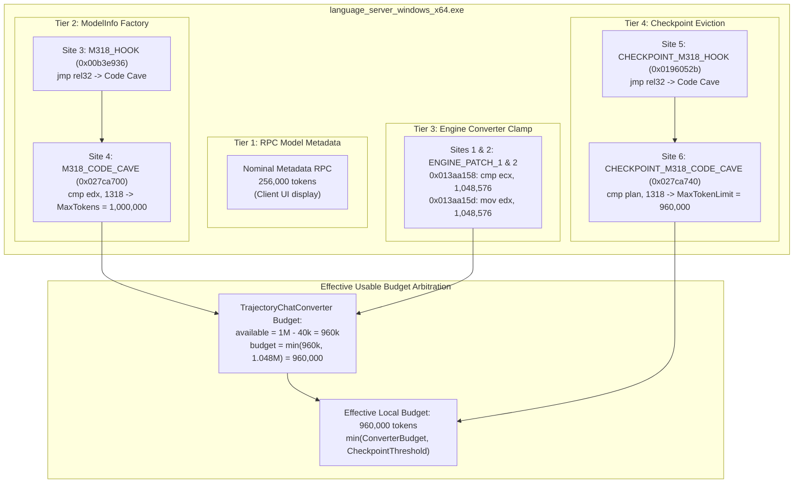

# Antigravity Context Patcher

> Experimental tooling for inspecting, validating, and extending Antigravity IDE context-window behavior with provenance-first token telemetry.

[](https://github.com/Sankalpa-KMCP/antigravity-context-patcher)
[](https://github.com/Sankalpa-KMCP/antigravity-context-patcher)
[](https://github.com/Sankalpa-KMCP/antigravity-context-patcher)
[](file:///D:/Antigravity-Context-Patcher/token-monitor/README.md)
[](file:///D:/Antigravity-Context-Patcher/LICENSE)
[](https://nodejs.org)

---

## 1. Overview

**Antigravity Context Patcher** is a research and engineering suite designed to analyze, safely patch, and accurately monitor context window limits in Google Antigravity IDE's core language server (`language_server_windows_x64.exe`).

By pairing automated PE32+ structural analysis with a non-invasive, provenance-first status bar telemetry extension, this repository provides both the binary modifications necessary to enable **1M context execution** for Gemini 3.8 Flash (High) and the real-time observability required to verify internal model and engine behavior without heuristic guesswork.

---

## 2. What It Does

1. **Lifts Internal Context Ceilings:** Safely overrides internal model allocations, raising `MODEL_PLACEHOLDER_M318` (`Gemini 3.8 Flash High` / key `1318`) from the nominal 256,000 token limit to 1,000,000 tokens.
2. **Harmonizes Engine & Checkpoint Constraints:** Elevates the internal `TrajectoryChatConverter` hard clamp to $1,048,576$ tokens ($2^{20}$) and shifts the conversation eviction threshold (`CheckpointConfig.MaxTokenLimit`) to 960,000 tokens to prevent premature turn dropping.
3. **Guarantees Negative Scope Isolation:** Uses isolated trampoline hooks and conditional code caves so that non-target models (M316, M317, M319, M320) remain bit-for-bit unchanged.
4. **Delivers Provenance-First Telemetry:** Bundles the **Antigravity Token Monitor** (v0.1.0), an autonomous IDE extension that surfaces live local trajectory estimates and authoritative backend prompt tokens (`inputTokens` + `cacheReadTokens`) with a strict Zero-Heuristic Policy.
5. **Provides Read-Only Patch Verification:** Includes automated verification scripts that audit all six patch sites and binary cryptographic hashes without modifying local files or conversation databases.

---

## 3. Current Validated Configuration

The repository represents the empirically validated configuration for `MODEL_PLACEHOLDER_M318` running on Windows x64:

| Parameter | Configuration Value | Provenance Class | Role in Context Engine |
| :--- | :--- | :--- | :--- |
| **Target Model** | Gemini 3.8 Flash (High) | `LIVE OBSERVED` | Active language model |
| **Internal Model Key** | `MODEL_PLACEHOLDER_M318` / `1318` | `VERIFIED STATIC` | Target descriptor key (`0x0526`) |
| **Nominal Metadata** | 256,000 tokens | `LIVE RPC` | **Non-binding** (Initial client UI display only) |
| **Patched ModelInfo MaxTokens** | 1,000,000 tokens | `VERIFIED STATIC` | Active runtime context limit |
| **Configured Reserve Floor** | 40,000 tokens | `VERIFIED STATIC` | Reserved headroom for completion |
| **Engine Hard Clamp** | 1,048,576 tokens | `VERIFIED STATIC` | Converter comparison ceiling ($2^{20}$) |
| **Checkpoint Threshold** | 960,000 tokens | `VERIFIED STATIC` | **Binding Local Constraint** (Eviction trigger) |
| **Effective Local Budget** | **960,000 tokens** | **`DERIVED`** | **Status Bar Denominator** |
| **Production Binary SHA-256** | `d7b8a84264019aacb56126fff438523e35039fd4dc313aa002189d630ac05779` | `VERIFIED STATIC` | Validated production image |

> [!IMPORTANT]
> **Nominal Metadata vs. Runtime Execution:**
> Antigravity's client-facing RPC continues to report `maxContextTokens = 256,000` because the client configuration table is serialized during conversation bootstrap. In the validated patched path, this nominal metadata is **non-binding**. The language server's active converter and checkpoint manager operate under the 960,000 token effective local budget.

---

## 4. Antigravity Token Monitor

The bundled extension ([`token-monitor/`](file:///D:/Antigravity-Context-Patcher/token-monitor/README.md)) displays live context telemetry in the IDE status bar:

```text
⚡ 222.3k+ / 960k | pending
```

### Telemetry Provenance Hierarchy
The monitor classifies every number into four unambiguous categories:
1. **`LIVE OBSERVED`:** Extracted directly from live Connect-RPC messages:
   - **Trajectory Estimate (`estimatedTokensUsed`):** Compiled by Antigravity's internal Go chat converter for the conversation.
   - **Backend Prompt (`inputTokens` + `cacheReadTokens`):** Actual same-record usage returned by the remote Gemini inference engine.
2. **`VERIFIED STATIC CONFIGURATION`:** Instruction immediates read directly from machine code on disk:
   - Engine Hard Clamp: `1,048,576`
   - M318 Runtime Ceiling: `1,000,000`
   - Checkpoint Eviction Threshold: `960,000`
3. **`DERIVED`:** Calculated strictly from verified operands:
   - Effective Local Budget: $\min(1M - 40k, 960k, 1.048M) = 960,000$
   - Local Remaining Tokens: $\text{Budget} - \text{Trajectory Estimate}$
   - Local Usage Percentage: $\frac{\text{Trajectory}}{\text{Budget}} \times 100$
4. **`UNAVAILABLE`:** Explicitly labeled whenever RPC records omit data. Never replaced with guessed numbers.

> [!NOTE]
> **Zero-Heuristic Policy:** The Token Monitor strictly forbids `chars / 4` approximations, byte-to-token division, or extrapolated progress. If turn generation is active, the monitor appends a `+` suffix (`222.3k+`) and marks state as `pending`.

---

## 5. Architecture

Antigravity arbitrates context through four decoupled layers:



For full architectural diagrams and PE structure analysis, see [docs/architecture.md](file:///D:/Antigravity-Context-Patcher/docs/architecture.md).

---

## 6. Installation

### Repository Setup
```bash
# Clone the repository
git clone https://github.com/Sankalpa-KMCP/antigravity-context-patcher.git
cd antigravity-context-patcher

# Install dependencies (zero production runtime dependencies)
npm install
```

### Installing Token Monitor in Antigravity IDE
1. Copy the `token-monitor/` folder to your Antigravity IDE extensions directory:
   ```powershell
   Copy-Item -Recurse -Force "token-monitor" "D:\Antigravity-IDE-Data\extensions\local.antigravity-token-monitor-0.1.0"
   ```
2. In Antigravity IDE, open the Command Palette (`Ctrl + Shift + P`) and execute:
   ```text
   Developer: Restart Extension Host
   ```
3. The status bar will immediately display the active session telemetry (`⚡ ... / 960k`).

---

## 7. Verification

Verify the live production binary at any time without modifying any files:

```bash
npm run verify
```

Expected output:
```text
====================================================
ANTIGRAVITY CONTEXT PATCHER — READ-ONLY VERIFIER
====================================================
Target Binary: D:\Antigravity IDE\resources\app\extensions\antigravity\bin\language_server_windows_x64.exe
File Size:     135,647,744 bytes
SHA-256:       d7b8a84264019aacb56126fff438523e35039fd4dc313aa002189d630ac05779
[PASS] Production hash matches verified 1M+960k checkpoint configuration

--- 6-SITE PATCH VERIFICATION ---
[PASS] Site 1 (ENGINE_PATCH_1): 1,048,576 tokens (Engine Hard Clamp CMP Immediate)
[PASS] Site 2 (ENGINE_PATCH_2): 1,048,576 tokens (Engine Hard Clamp MOV Immediate)
[PASS] Site 3 (M318_HOOK): ModelInfo M318 Trampoline Hook (jmp 0x27cb300; 6-byte nop)
[PASS] Site 4 (M318_CODE_CAVE): Runtime limit 1,000,000 tokens for key 1318
[PASS] Site 5 (CHECKPOINT_M318_HOOK): CheckpointConfig M318 Trampoline Hook (jmp 0x27cb340; 9-byte nop)
[PASS] Site 6 (CHECKPOINT_M318_CODE_CAVE): Checkpoint threshold 960,000 tokens for key 1318

--- VERIFICATION RESULT ---
STATUS: FULLY VERIFIED (All 6 patch sites and production SHA match expected 1M/960k configuration)
```

See [docs/patch-verification.md](file:///D:/Antigravity-Context-Patcher/docs/patch-verification.md) for disassembly and byte listings.

---

## 8. Safety Model

- **Zero Database Writes:** The patcher and monitor **never write to SQLite conversation databases** (`*.db`, `*.db-wal`, `*.db-shm`). All telemetry is queried via memory-safe, read-only Connect-RPC.
- **Isolated Staging:** Modified executables are built strictly in `staging/`. Live executables are never modified in place while running.
- **Guarded Apply-on-Exit:** Binary promotion waits for processes to exit, captures a timestamped SHA-256 backup in `backups/`, and performs post-copy verification with automatic rollback.
- **Fail-Closed Scanner:** Aborts if any signature matches zero or multiple times ($N \ne 1$).

Detailed emergency rollback procedures are documented in [docs/safety.md](file:///D:/Antigravity-Context-Patcher/docs/safety.md).

---

## 9. Token Semantics & Accounting

**Local Trajectory Estimate $\ne$ Backend Gemini Token Count.**

| Dimension | Trajectory Estimate (`estimatedTokensUsed`) | Backend Prompt (`inputTokens` + `cacheReadTokens`) |
| :--- | :--- | :--- |
| **Origin** | Local Antigravity Language Server | Remote Gemini Inference Engine |
| **Scope** | Serialized conversation history turns | Full HTTP payload (system prompts, tool schemas, results) |
| **Breakdown** | Monolithic integer | Uncached prompt (`inputTokens`) + Cached prefix (`cacheReadTokens`) |
| **Role** | Local budget management & eviction trigger | Inference billing and model context consumption |

The Token Monitor enforces **strict same-record pairing**: backend usage metrics are only displayed if they share the exact same record index as the trajectory turn, preventing deceptive cross-turn attribution.

For complete token definitions, see [docs/token-metrics.md](file:///D:/Antigravity-Context-Patcher/docs/token-metrics.md).

---

## 10. Testing

Run the complete automated verification test suite:

```bash
npm test
```

This runs:
1. `npm run test:patcher`: PE integrity, 64-byte diff isolation, branch displacements, and negative-scope static emulation for model keys 1316 through 1320.
2. `npm run test:monitor`: Clamp inspector validation, Connect-RPC parsing, dual-tier state machine, string formatting, and a zero-heuristic codebase audit.

---

## 11. Troubleshooting

| Symptom | Cause | Remedy |
| :--- | :--- | :--- |
| Status bar shows `256k` denominator | Extension Host running cached code | Run `Developer: Restart Extension Host` in Antigravity |
| Status bar shows `disconnected` | Language server process not found | Ensure Antigravity IDE is open with an active workspace |
| Status bar shows `awaiting turn` | Language server process was recycled | Submit a message to generate a turn under the new session |
| Hash mismatch on `npm run verify` | IDE updated the binary | Run `npm run scan` to inspect updated instruction offsets |

Comprehensive diagnostics are provided in [docs/troubleshooting.md](file:///D:/Antigravity-Context-Patcher/docs/troubleshooting.md).

---

## 12. Project Status

- **M318 1M Context Patch:** **Empirically Validated** (Active trajectories up to 882k tokens and backend context up to 720k tokens verified with zero premature eviction).
- **Token Monitor:** **v0.1.0 Released** (Production verified in running IDE).
- **Automation:** Version-independent structural scanner and read-only verification tools complete.

---

## 13. Disclaimer

> [!CAUTION]
> This project is experimental reverse-engineering tooling intended for research and educational purposes. Modifying compiled binaries carries inherent risks. Always maintain verified offline backups of original executables before applying any binary modifications.

Antigravity, Gemini, and related names are trademarks of their respective owners. This project is independent and unofficial. It is not affiliated with, sponsored by, or endorsed by Google, DeepMind, or any associated entity.

---

## 14. License

This project is licensed under the [MIT License](file:///D:/Antigravity-Context-Patcher/LICENSE).
