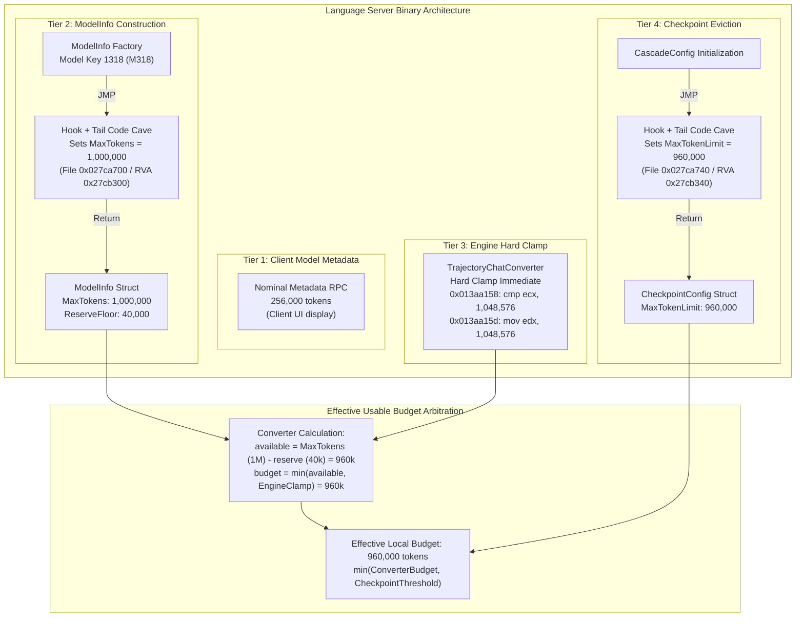
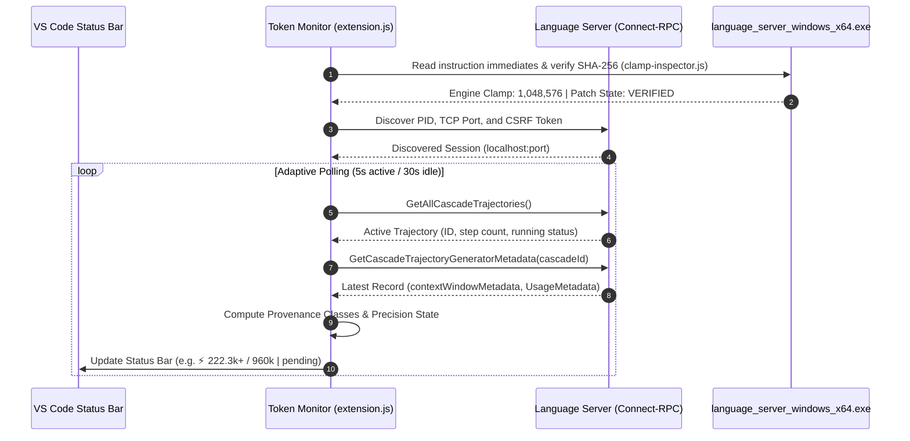

# Antigravity Context Patcher Architecture

This document provides a comprehensive technical overview of the multi-tier context window pipeline in the Google Antigravity IDE language server (`language_server_windows_x64.exe`), the structural reverse-engineering discoveries that govern context constraints, and the mechanical design of the 1M context patch and provenance-first Token Monitor.

---

## 1. Multi-Tier Context Pipeline

A fundamental finding in Antigravity architecture is that **context limits are enforced across four distinct, decoupled subsystems**, rather than a single global variable:

### Tier 1: Nominal RPC Metadata (256,000 tokens)
- **Source:** Connect-RPC `contextWindowMetadata.maxContextTokens`.
- **Function:** Sent to the frontend client to initialize IDE UI widgets.
- **Behavior:** Static configuration string emitted during conversation bootstrap. In the stock binary, this matches the internal model table. In the patched binary, **nominal 256k metadata remains visible over RPC but is non-binding** for the patched M318 model execution path.

### Tier 2: ModelInfo Runtime Limits (1,000,000 tokens)
- **Source:** `ModelInfo` constructor inside `language_server_windows_x64.exe`.
- **Function:** Instantiates the internal model descriptors governing context sizing, token allocation, and cost accounting.
- **Patched State:** Overridden via trampoline jump to a tail code cave for model key `1318` (`MODEL_PLACEHOLDER_M318` / Gemini 3.8 Flash High). Writes `0x000F4240` ($1,000,000$) to `[rax + 0x14]`.

### Tier 3: Engine Converter Hard Clamp (1,048,576 tokens)
- **Source:** `TrajectoryChatConverter` serialization engine.
- **Function:** An internal ceiling that caps maximum allowed tokens regardless of what model metadata requests:
  $$\text{converterTokens} = \min(\text{ModelInfo.MaxTokens} - \text{reserve}, \text{EngineHardClamp})$$
- **Stock Value:** $128,000$ or $256,000$ tokens in early releases.
- **Patched State:** Immediates at file offsets `0x013aa158` (`cmp ecx, imm32`) and `0x013aa15d` (`mov edx, imm32`) patched to `0x00100000` ($1,048,576$ tokens, exactly $2^{20}$).

### Tier 4: Checkpoint Eviction Threshold (960,000 tokens)
- **Source:** `CascadeConfig.CheckpointConfig.MaxTokenLimit`.
- **Function:** Governs conversation truncation and context compaction. If estimated conversation tokens exceed this threshold, Antigravity triggers local checkpoint eviction, truncating older turns.
- **Stock Value:** $256,000$ tokens.
- **Patched State:** Overridden via trampoline hook and code cave at `CascadeConfig` initialization to write `0x000EA600` ($960,000$) for M318. This prevents eviction until the active trajectory reaches 960k tokens.

---

## 2. Effective Local Usable Budget Calculation

The active budget displayed by the Token Monitor and utilized by Antigravity is strictly derived from the minimum binding constraint:

$$\text{Usable Budget} = \min\Big(\big(\text{PatchedMaxTokens} - \text{ReservedFloor}\big), \text{CheckpointThreshold}, \text{EngineHardClamp}\Big)$$

$$\text{Usable Budget} = \min\big((1,000,000 - 40,000), 960,000, 1,048,576\big) = 960,000 \text{ tokens}$$

| Constraint Component | Value | Constraint State |
| :--- | :--- | :--- |
| **Nominal Metadata** | 256,000 | Non-binding (Client RPC display only) |
| **Patched ModelInfo MaxTokens** | 1,000,000 | Active runtime ceiling |
| **Configured Reserve Floor** | 40,000 | Preserved headroom for generation |
| **Engine Hard Clamp** | 1,048,576 | Headroom available (does not bind) |
| **Checkpoint Threshold** | 960,000 | **Binding Local Constraint** |
| **Effective Local Budget** | **960,000** | **Status Bar Denominator** |

---

## 3. PE32+ Trampoline Hook & Code Cave Mechanics

### Memory Layout & Alignment
- The binary is a 64-bit Windows PE32+ executable compiled with Go and C++ toolchains.
- The `.text` section virtual address base is `0x00401000`.
- File offsets and RVAs differ by the PE section alignment ($0x400$ bytes between raw file offset and RVA in the tail padding area).
- Unused slack space in the executable image (code cave) is utilized at RVA `0x027cb300` (file offset `0x027ca700`).

### Trampoline 1: ModelInfo Hook (Sites 3 & 4)
- **Hook Site:** File `0x00b3e936` (RVA `0x00b3f536`).
- **Opcode Replacement:** Replaces 11 bytes of standard field initialization with a 5-byte relative near jump (`E9 C5 BD C8 01`) and a 6-byte multi-byte NOP (`66 0F 1F 44 00 00`).
- **Code Cave Logic:**
  1. Checks if the model key in register `edx` equals `0x0526` ($1318$).
  2. If matched: writes `1,000,000` (`0x000F4240`) to `[rax + 0x14]`.
  3. If not matched: writes standard stock value `256,000` (`0x0003E800`).
  4. Preserves all other registers (`rbx`, `rcx`, `rdi`).
  5. Jumps back to continuation point at RVA `0x00b3f541`.

### Trampoline 2: CheckpointConfig Hook (Sites 5 & 6)
- **Hook Site:** File `0x0196052b` (RVA `0x196112b`).
- **Opcode Replacement:** Replaces 14 bytes with a 5-byte relative near jump (`E9 10 A2 E6 00`) and a 9-byte multi-byte NOP (`66 0F 1F 84 00 00 00 00 00`).
- **Code Cave Logic:**
  1. Inspects the model plan key located on stack at `[rsp + 0xa4]`.
  2. Compares against `0x0526` ($1318$).
  3. If matched: writes `960,000` (`0x000EA600`) to `[rax + 0x14]`.
  4. If not matched: leaves default limit (`256,000`).
  5. Jumps back to continuation point at RVA `0x01961139`.

---

## 4. Token Monitor Architecture

The Token Monitor (`token-monitor/`) is an autonomous, dependency-free VS Code / Antigravity IDE extension designed with a strict **Zero-Heuristic Policy**:

### Key Subsystems:
1. **Clamp Inspector (`clamp-inspector.js`):** Reads binary opcodes directly from disk using raw `fs.readSync` at designated offsets. Computes cached SHA-256 and validates whether the running binary contains verified patches.
2. **Language Server Client (`ls-client.js`):** Discovers running process arguments on localhost without external network calls. Connects via HTTP/2 Connect-RPC using session CSRF headers.
3. **Active Cascade Resolver (`active-cascade-resolver.js`):** Detects active editor files and associates them with the running conversation cascade, gracefully handling multi-cascade scenarios.
4. **Telemetry Tracker (`telemetry-tracker.js`):** Enforces strict same-record pairing between local trajectory estimates and backend usage metadata. Detects Language Server recycles and marks stale sessions.
5. **Status Bar Manager (`statusbar.js`):** Renders clean, high-density status bar indicators with interactive quick-pick inspection dialogs.
