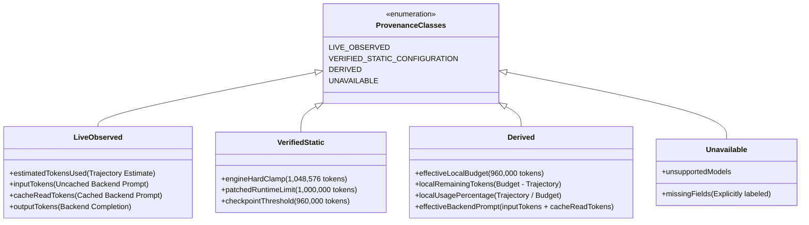

# Provenance-First Token Semantics & Metrics

This document details the telemetry model, provenance taxonomy, and token accounting principles implemented in the Antigravity Token Monitor.

---

## 1. Zero-Heuristic Policy

The Antigravity Token Monitor enforces a strict **Zero-Estimation Policy**:
- **NO `chars / 4` approximations**
- **NO byte-to-token division**
- **NO extrapolated turn progress**
- **NO synthetic or fabricated numbers**

Every value rendered in the status bar or detailed inspection modal originates from either:
1. **Authoritative binary instruction immediates** verified on disk, or
2. **Authoritative Connect-RPC protocol payloads** emitted by the language server.

If telemetry is in flight or has not been computed for an in-progress generation, the monitor honestly reports the metric as `PENDING` (`⚡ 222.3k+ / 960k | pending`) or `UNAVAILABLE`, rather than guessing.

---

## 2. Telemetry Provenance Taxonomy

Every displayed metric belongs to one of four unambiguous provenance classes:



### Class 1: `LIVE OBSERVED`
Directly extracted from the latest generator record (`generatorMetadata[latest]`):
- **Trajectory Estimate (`estimatedTokensUsed`):** The local token count calculated by Antigravity's internal Go chat converter before dispatching the request.
- **Backend Uncached Prompt (`inputTokens`):** The exact number of new, non-cached tokens processed by Gemini inference for that turn.
- **Backend Cached Prompt (`cacheReadTokens`):** The exact number of context tokens served from Gemini's prompt cache.
- **Backend Output (`outputTokens`):** The tokens generated by the model in response.

### Class 2: `VERIFIED STATIC CONFIGURATION`
Directly verified from executable machine code on disk:
- **Engine Hard Clamp (`1,048,576`):** Extracted from `cmp ecx, imm32` and `mov edx, imm32` at file offsets `0x013aa158` and `0x013aa15d`.
- **M318 Runtime MaxTokens (`1,000,000`):** Encoded in the tail code cave for model key `1318`.
- **Checkpoint Eviction Threshold (`960,000`):** Encoded in the tail code cave for `CascadeConfig`.

### Class 3: `DERIVED`
Mathematically computed from verified operands without heuristics:
- **Effective Local Budget (`960,000`):**
  $$\text{Effective Budget} = \min\big((\text{RuntimeMaxTokens} - \text{ReserveFloor}), \text{CheckpointThreshold}, \text{EngineClamp}\big) = 960,000$$
- **Effective Backend Prompt (`inputTokens + cacheReadTokens`):** The true total prompt size processed by the Gemini inference engine.
- **Local Remaining Tokens:** $\text{Effective Budget} - \text{Trajectory Estimate}$.
- **Local Usage Percentage:** $\frac{\text{Trajectory Estimate}}{\text{Effective Budget}} \times 100$.

### Class 4: `UNAVAILABLE`
Reported when a record omits fields or when a turn is incomplete. The monitor displays `unavailable` or suppresses percentages instead of inventing numbers.

---

## 3. Trajectory Estimate vs. Backend Gemini Tokens

A critical point of confusion in LLM telemetry is conflating client trajectory estimates with backend token counts. **They are fundamentally different measurements**:

$$\text{Trajectory Estimate} \ne \text{Backend Prompt Tokens}$$

| Metric Dimension | Trajectory Estimate (`estimatedTokensUsed`) | Backend Prompt (`inputTokens + cacheReadTokens`) |
| :--- | :--- | :--- |
| **Computing Entity** | Local Antigravity Language Server | Remote Gemini Inference Engine |
| **Tokenizer** | Local conservative tokenizer / conversion rules | Production Gemini BPE Tokenizer |
| **Payload Scope** | Conversation history serialized as chat turns | Complete HTTP payload: system instructions, tool definitions, tool results, formatting wrappers |
| **Caching Split** | None (monolithic estimate) | Divided into `cacheReadTokens` (cached) and `inputTokens` (uncached) |
| **Purpose** | Local budget management and checkpoint eviction triggers | Billing, inference latency, and server-side context capacity |

### Why Trajectory Estimates Differ From Backend Counts
1. **Tool Definitions & Schema Overhead:** Antigravity injects dozens of rich tool schemas and system instructions into the Gemini request. These add backend tokens not always fully mirrored in local message estimates.
2. **Prompt Cache Boundaries:** Gemini caches prefix tokens in discrete chunks. The backend reports exact cache hits (`cacheReadTokens`), whereas local trajectory estimation measures total conversation length.
3. **Conservative Headroom:** Antigravity's local converter errs on the side of caution to avoid unexpected HTTP 400 Context Window Exceeded errors.

---

## 4. Authoritative Configuration Comparison Table

| Parameter | Value | Provenance Class | Binding Role |
| :--- | :--- | :--- | :--- |
| **Nominal Metadata** | `256,000` | `LIVE RPC` | **Non-binding** (Initial client UI display only) |
| **M318 Runtime Config** | `1,000,000` | `VERIFIED STATIC` | Target model context ceiling |
| **Checkpoint Threshold** | `960,000` | `VERIFIED STATIC` | **Binding Local Constraint** (Eviction boundary) |
| **Engine Hard Clamp** | `1,048,576` | `VERIFIED STATIC` | Engine converter ceiling ($2^{20}$) |
| **Effective Local Budget** | **`960,000`** | **`DERIVED`** | **Status Bar Denominator** |

---

## 5. Same-Record Pairing & Anti-Staleness Rules

To prevent misleading telemetry, the Token Monitor enforces two strict integrity rules:

### Rule A: Strict Same-Record Pairing
Backend usage (`inputTokens`, `cacheReadTokens`, `outputTokens`) is only associated with a trajectory estimate if they originate from the **exact same generator metadata record index**.
- The monitor **never** borrows usage metadata from turn $N-1$ and pairs it with trajectory turn $N$.
- If turn $N$ is still generating, the trajectory estimate is shown with a `+` suffix (`⚡ 222.3k+ / 960k | pending`), and backend usage remains attributed to the last completed turn.

### Rule B: Language Server Recycle Detection (`STALE_SESSION`)
If the Language Server process restarts, old generator records stored in client memory or cached RPC calls are recognized as stale:
- The monitor compares process start times.
- If generator metadata predates the current session start time, the status bar enters `STALE_SESSION` mode:
  ```text
  ⚡ 142.1k+ | model 256k | awaiting current-session turn
  ```
- Percentages are suppressed until a turn is executed under the active session.
